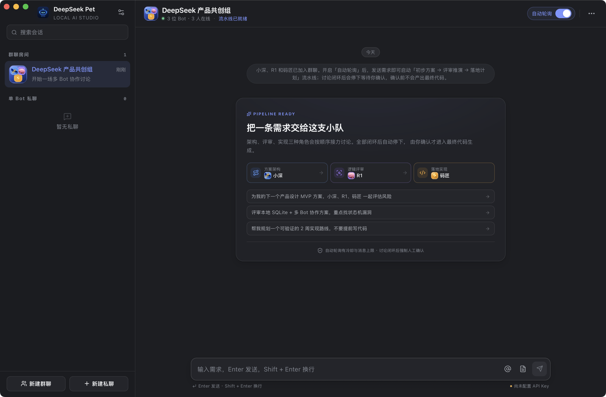

# DeepSeek Bot Group Pet

一款运行在 macOS 上的本地 AI 工作台：微信 Mac 风格的多 Bot 群聊、按角色接力的讨论流水线、Muse 风格的三层文本记忆，以及一只常驻桌面的赛博机器人桌宠。

- **前端**：Vue 3 + TypeScript + Vite + UnoCSS + Reka UI + Motion Vue + Lucide
- **桌面容器**：Tauri 2（Rust）
- **本地数据**：普通 SQLite（不使用向量数据库、Embedding 或本地相似度检索）
- **远程推理**：仅在调用模型时由 Rust 后端请求 DeepSeek API
- **平台**：macOS（Intel / Apple Silicon）

> DeepSeek 系列模型是程序调用的远程推理 API；Tauri、Vue 与 SQLite 是本地客户端技术栈，二者不是同一层级。

<p align="center">
  
  
  
  
  
  
  <a href="https://github.com/jgslm9527/deepseek-bot-group-pet"></a>
</p>

---

## 功能一览

| 模块 | 你能得到什么 |
| --- | --- |
| 桌面桌宠 | 120×120 透明置顶窗口、透明区穿透、拖拽、原生右键菜单、呼吸/思考/新消息动画 |
| 多 Bot 群聊 | 微信 Mac 风格布局，每个 Bot 独立头像、配色、人设、模型与参数 |
| 协作流水线 | Chat 提案 → R1 评审推演 → 实现 Bot 落地计划 → 修订闭环，随后强制人工确认 |
| 安全落地 | 确认前不生成最终代码，不自动执行生成物；支持停止、超时中断与驳回重议 |
| Muse 记忆 | 短期上下文 + Bot 独立文本记忆 + 全局用户档案；LLM 相关记忆筛选、后台抽取、合并去重、低置信度审核 |
| 本地优先 | 聊天记录、人设、记忆均存普通 SQLite；不使用向量库、Embedding 或本地相似度检索 |
| 可观测性 | 按 Bot、房间、模型和调用类型统计 Token 消耗，展示近 14 天用量 |
| 原生体验 | Tauri 2 原生窗口、macOS 浅色/深色跟随、快捷键、CSP 与密钥隔离 |

---

## 截图

<p align="center">
  
</p>

<p align="center">
  
  <br />
  <sub>桌宠为 120×120 透明原生窗口，形象由本地 SVG 绘制</sub>
</p>

---

## 已实现功能

### 1. 桌宠精灵

- 120 × 120 无边框、全透明、置顶、所有工作区可见
- 透明区域鼠标穿透，只有机器人本体区域接收点击（Rust 全局光标命中检测）
- 左键点击唤起/前置主窗口；关闭主窗口只隐藏，程序与桌宠继续运行
- 右键原生菜单：打开设置、全部 Bot 静音、退出应用
- 拖拽移动并记忆位置；悬停出现底部拖拽点与提示
- 状态动画：空闲呼吸、思考时眼睛扫描/轨道旋转、新消息弹跳 + 迷你气泡、错误/静音状态
- 主窗口 ↔ 桌宠通过 Tauri 事件与 Rust command 实时通信

### 2. 微信 Mac 风格主窗口

- 左侧会话列表：搜索、群聊房间、单 Bot 私聊、新建入口
- 中间聊天区：用户绿色气泡、Bot 彩色气泡与独立头像、居中系统提示、正在思考动画
- 底部输入框：单行自动伸展、`@` 成员选择、文本/代码文件附件、发送与停止
- 右侧详情：成员列表、Bot 编辑、静音/踢出、流水线参数、记忆管理
- `⌘,` 打开设置；`⌘N` 新建群聊；`⌘⇧N` 新建私聊；`⌘W` 隐藏主窗口

### 3. 多 Bot 流水线

默认内置三个角色，也可在 Bot 编辑弹窗中改模型/人设/参数（模型决定流水线角色）：

| 角色 | 默认 Bot | 模型 |
| --- | --- | --- |
| 方案架构 | 小深 | `deepseek-chat` |
| 逻辑评审 | R1 | `deepseek-reasoner` |
| 落地实现 | 码匠 | `deepseek-flash-v4` |

群内开启「自动轮询」后，发送需求会启动：

`初步方案 → 评审推演 → 落地计划 → 方案修订 → 闭环复核 → 实现准备`

- 可配置发言冷却、单轮最大自动消息数、短期上下文条数
- 达到流程上限后**强制停止轮询**，弹出人工确认窗口
- 确认前不会生成最终代码；点击「确认开始实现」后才由实现角色生成代码
- 驳回时可填写修改意见，直接回到群内继续修订讨论
- 可随时点击顶部「自动讨论中」或输入框红色按钮停止
- 关闭「自动轮询」后，仅响应 `@Bot 名称`；私聊始终直接回复
- API 超时、错误或手动停止会中断自动轮询并保留已有内容

### 4. Muse 风格长期记忆

**三层存储**

1. 每房间最近 N 条短期上下文（随请求预算自动截断）
2. 每个 Bot 独立记忆：ID、摘要、正文、标签、重要度、来源房间、时间、置信度、状态
3. 全局用户档案：所有 Bot 默认读取

**相关记忆筛选**

每次 Bot 正式回复前，先发起一次轻量辅助调用：只把「当前需求 + 该 Bot 可用记忆的 ID/摘要/标签」发给模型，让模型返回相关记忆 ID；随后才加载这些 ID 的完整文本。不会发送无关记忆，也不使用向量检索。

**后台抽取与合并**

- 每轮讨论结束后异步抽取，不阻塞聊天
- 只保留长期有效的规则、参数、约束、共识与偏好；过滤客套话和一次性问答
- 模型可返回 `add/update/skip`，优先把相似内容合并进旧记忆
- 本地额外做精确摘要/正文去重作为安全网
- 置信度低于 0.65 进入「待审核」，手动通过后才参与检索
- 每个 Bot 默认上限 30 条；超限只淘汰重要度 ≤ 3 的旧记忆，重要度 4–5 永不自动淘汰
- Bot 级自动记忆开关、本群共享开关、读取范围（全部房间/仅当前房间）
- 记忆面板支持新增、编辑、单条删除、批量归档、恢复、清空、审核

### 5. 其它

- 首次启动自动建表并写入默认 Bot、群聊和用户档案，无需执行 SQL
- Token 消耗面板：分 Bot、房间、模型、调用类型与近 14 天统计
- 自动跟随 macOS 浅色/深色外观（`prefers-color-scheme`）
- 所有 UI 依赖均为免费开源软件，无付费组件、无外部字体、无带水印素材
- CSP、DOMPurify 清洗 Markdown、API Key 仅保存在 Rust 侧配置文件

---

## 快速开始

### 环境要求

| 依赖 | 要求 | 说明 |
| --- | --- | --- |
| macOS | 11 Big Sur 或更高 | Intel 与 Apple Silicon 均可构建 |
| Node.js | ≥ 20.19 | 前端构建与 Tauri CLI |
| pnpm | ≥ 9 | 推荐使用仓库声明的 pnpm 10 |
| Rust | stable | 建议通过 rustup 安装 |
| Xcode CLT | 已安装 | `xcode-select --install` |
| DeepSeek API | 有效的 API Key | 仅在调用模型时需要联网 |

```bash
git clone https://github.com/jgslm9527/deepseek-bot-group-pet.git
cd deepseek-bot-group-pet

pnpm install

# 开发模式（启动 Vite + Tauri 原生窗口）
pnpm tauri dev

# 构建 .app / .dmg
pnpm tauri build
```

仅运行 `pnpm dev` 只会在浏览器里打开渲染层，没有 SQLite、原生窗口和桌宠；请使用 `pnpm tauri dev`。

构建产物默认未签名/未公证。仅在本机运行时可以直接打开；如果需要对外分发，请自行使用 Apple Developer 证书进行 `codesign` 与公证。

### 首次配置

1. 首次启动会自动打开设置；也可以在左下角齿轮或桌宠右键菜单打开。
2. 填入 DeepSeek API Key，默认 Base URL 为 `https://api.deepseek.com`。
3. 点击「保存 API 配置」，可点「测试连接」验证。
4. 回到默认群聊发送需求即可。

Key 只写入本机：

```text
~/Library/Application Support/com.deepseek.grouppet/config.json
```

SQLite 数据库：

```text
~/Library/Application Support/com.deepseek.grouppet/deepseek-pet.db
```

这两个路径都在源码仓库之外；`config.json` 同时被 `.gitignore` 排除。

### 模型名称

模型下拉框使用需求中的四个 ID：

- `deepseek-chat`
- `deepseek-reasoner`
- `deepseek-flash-v4`
- `deepseek-v4-pro`

是否可用取决于你的 DeepSeek 账户/网关实际开放的模型列表。若某个 ID 不可用，设置页可改 Base URL 指向兼容网关，或在 `src/types/index.ts` 中调整模型选项与角色映射。

---

## 目录结构

```text
.
├── index.html                  # 主窗口入口
├── pet.html                    # 桌宠窗口入口
├── src/
│   ├── windows/
│   │   ├── MainWindow.vue      # 主窗口布局
│   │   └── PetApp.vue          # 桌宠、命中检测、拖拽、状态
│   ├── components/
│   │   ├── chat/               # 消息、输入框、确认弹窗、起始卡片
│   │   ├── layout/             # 侧栏、详情栏
│   │   ├── bots/               # Bot 编辑、头像
│   │   ├── memory/             # 记忆面板、编辑弹窗
│   │   ├── settings/           # 设置、额度统计
│   │   ├── rooms/              # 新建群聊/私聊、添加成员
│   │   ├── pet/PetRobot.vue    # 纯 SVG 桌宠形象
│   │   └── ui/                 # Reka UI 封装的 Dialog/Switch/Toast
│   ├── stores/
│   │   ├── chat.ts             # 会话、流水线调度、停止/确认
│   │   ├── memory.ts           # 记忆管理状态
│   │   ├── settings.ts         # API、偏好、用量
│   │   └── ui.ts               # 弹窗、Toast、确认
│   ├── lib/
│   │   ├── repos/              # SQLite 数据访问
│   │   ├── memory-engine.ts    # 记忆筛选、异步抽取、合并/淘汰
│   │   ├── prompts.ts          # 各阶段提示词与上下文拼装
│   │   ├── context.ts          # token 估算、短期上下文截断
│   │   ├── tauri.ts            # Rust command 封装
│   │   └── markdown.ts         # marked + DOMPurify
│   └── styles/global.css       # 设计变量、浅/深色主题、组件样式
├── src-tauri/
│   ├── migrations/0001_init.sql # 自动建表 + 默认数据
│   ├── src/
│   │   ├── lib.rs              # Tauri 启动、窗口生命周期、菜单
│   │   ├── api.rs              # DeepSeek 请求/超时/错误处理
│   │   ├── config.rs           # 本机 API Key 配置（0600）
│   │   ├── window.rs           # 桌宠菜单、穿透命中、主窗口控制
│   │   └── macos.rs            # 全局光标、跨工作区、初始位置
│   ├── capabilities/default.json
│   └── tauri.conf.json
├── scripts/generate-icons.py   # 代码生成本地图标
└── README.md
```

---

## 数据表

首次启动由 `tauri-plugin-sql` 执行迁移：

- `bots`：Bot 人设、模型、温度、最大 token、记忆配置
- `rooms`：会话、自动轮询、冷却、消息上限、上下文条数
- `room_bots`：房间成员关系
- `messages`：聊天记录、附件 JSON、元数据
- `memories`：长期记忆（文本 / 标签 / 重要度 / 状态 / 来源）
- `usage_logs`：token、模型、调用类型、延迟
- `user_profile`：全局用户档案
- `app_settings`：全局偏好
- `discussions`：讨论阶段、轮次、待确认状态

---

## 安全与边界

- API Key 只在 Rust 后端读取，不进入 WebView、不写入 SQLite、不打印日志
- 配置写入临时文件后 `rename`，Unix 权限 `0600`
- 所有模型请求由 Rust 发起，前端不直接访问 DeepSeek
- Markdown 渲染使用 `marked`，输出经 `DOMPurify` 清洗
- Tauri CSP 限制脚本、样式、图片与连接来源
- 讨论阶段通过提示词硬约束不输出完整代码；最终代码生成必须经过人工确认
- 生成物只会显示为文本，**不会自动执行任何命令**
- 上传附件只接受文本/代码文件（≤ 500 KB、最多 3 个），内容随消息保存在本机 SQLite

## 已知限制

- 单次模型回复为非流式；生成期间显示思考状态，不展示逐字流。
- 桌宠透明穿透采用 160 ms 光标轮询 + `set_ignore_cursor_events`，在极快速点击时可能有一帧延迟。
- 记忆抽取由模型判断相似度；本地仅做精确重复兜底，不引入向量检索（符合产品约束）。
- 若模型 ID 或账户权限不可用，会在聊天中显示 API 错误并停止自动轮询。
- 桌宠位置以物理像素持久化，跨不同缩放的显示器移动后如出现偏移，拖动一次即可重新保存。

## 已验证项

本次交付在 macOS 15.7.7（Intel）上完成以下验证：

- `pnpm build`（vue-tsc + Vite）通过
- `cargo check` 与 `pnpm tauri build --bundles app` 通过
- 首次启动自动建表、默认 Bot/房间/用户档案初始化
- 使用本地 OpenAI-compatible mock 完成端到端验证：6 轮自动讨论、讨论闭环、确认后生成最终代码、拒绝并继续修订、自动轮询停止、私聊、记忆前置筛选、后台抽取与去重、Token 统计
- 桌宠透明/置顶/悬浮点击、原生右键菜单、拖拽与位置持久化、全部静音、退出应用
- CSP 生产环境正常工作

真实 DeepSeek 调用需要你自己的 API Key，以及账户实际开放的模型权限。未在仓库中保存任何真实密钥。

## 开源依赖

Rust：Tauri 2（Apache-2.0 / MIT）、tauri-plugin-sql（Apache-2.0 / MIT）、reqwest（Apache-2.0 / MIT）、serde（Apache-2.0 / MIT）、tokio（MIT）等。

前端：Vue（MIT）、Vite（MIT）、UnoCSS（MIT）、Reka UI（MIT）、Motion Vue（MIT）、Lucide（ISC）、marked（MIT）、DOMPurify（Apache-2.0 / MPL-2.0）、Pinia（MIT）。

应用图标与桌宠 SVG 均由 `scripts/generate-icons.py` / 本地 SVG 代码绘制，无第三方素材。

## 通用构建（Intel + Apple Silicon）

```bash
rustup target add x86_64-apple-darwin aarch64-apple-darwin
pnpm tauri build --target universal-apple-darwin
```

在单架构机器上直接 `pnpm tauri build` 会生成对应架构的 `.app` / `.dmg`。

---

仓库地址：<https://github.com/jgslm9527/deepseek-bot-group-pet>

**讨论闭环不是终点，人工确认才是。**
